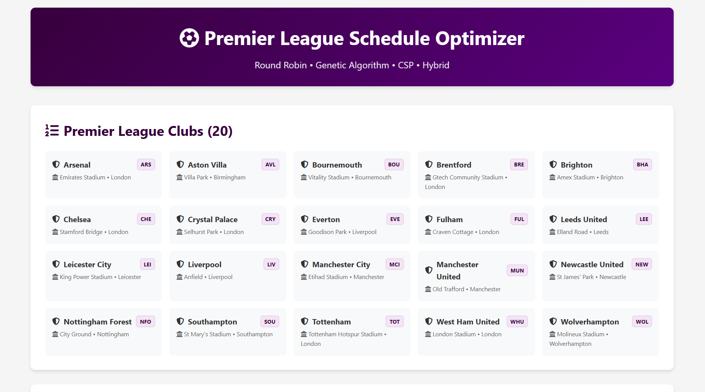
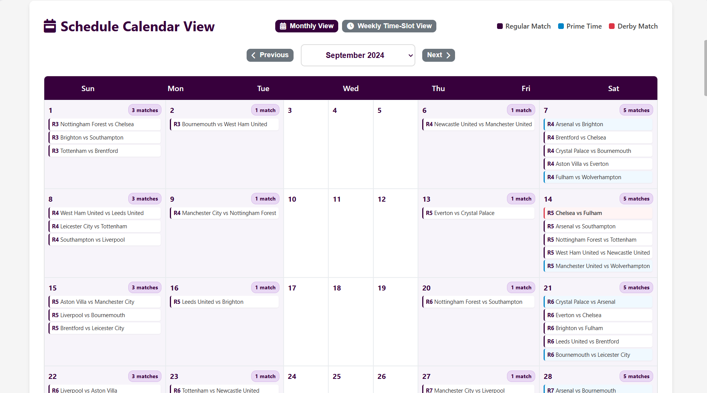
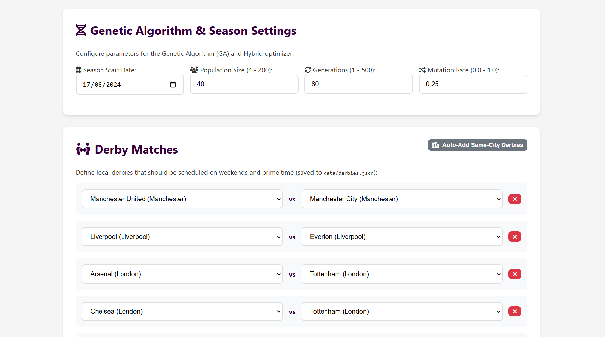

# Premier League Schedule Optimizer


An intelligent, multi-objective tournament scheduling and optimization system for the **English Premier League (20 Clubs, 38 Matchweeks, 380 Matches)** powered by **Berger Round-Robin Tables**, **Genetic Algorithm (GA)**, and **Constraint Satisfaction Problem (CSP)** solvers. It guarantees 100% compliance with all hard constraints (no fixture conflicts, balanced double round-robin pairings, and multi-period stadium availability lockouts) while minimizing soft penalties such as consecutive home/away streaks, minimum round separation between reverse fixtures, same-city police/traffic clashes, and prime-time broadcast targets.

---

## Demo / Screenshot / GIF

### 1. Main Dashboard, 4-Algorithm Benchmark & GA Convergence Curve


### 2. Full Schedule Calendar (Monthly / Weekly Time-Slot) & 38-Round Home/Away Matrix


### 3. Schedule Constraints & Genetic Algorithm Configuration


---

## Features

- **4 Modular Scheduling & Optimization Engines**:
  - **Round Robin (`RoundRobinScheduler`)**: Constructs a balanced 38-round double round-robin baseline schedule using the Berger Table rotation algorithm.
  - **Genetic Algorithm (`GAScheduler`)**: Evolves schedules using *Tournament Selection*, structure-preserving *Order Crossover (OX)*, *Symmetric Mutation* (round swaps, first/second-leg home-away inversions, and kickoff slot shifts), and *Multi-stage Repair*.
  - **Constraint Satisfaction (`CSPScheduler`)**: Enforces stadium availability windows, separates same-city rival home games (*Police / City Clash Rule*), and schedules local derbies on weekends and prime-time broadcast slots.
  - **Hybrid Pipeline (`HybridScheduler`)**: Combines `Round Robin -> Genetic Algorithm -> CSP Solver` sequentially to achieve minimal soft constraint penalties alongside strict broadcast and urban security compliance.
- **100% Hard Constraint Enforcement & Auto-Repair**: Validates and automatically resolves all 5 hard constraints, including single or multi-range stadium blackout periods (`stadium_availability`) via date shifting or symmetric reverse-fixture home/away swapping.
- **One-Click 4-Algorithm Benchmark (`Compare All 4 Algorithms`)**: Runs all four scheduling engines under identical constraints on the web dashboard to compare execution time (`ms`), soft penalty score, home/away streak breaks (`> 2`), same-city clashes, and minimum leg separation.
- **Rich Interactive Visualizations**:
  - Real-time **GA Convergence Curve** (*Soft Penalty vs. Generation*) rendered with Chart.js.
  - **38-Round Home / Away Sequence Matrix** highlighting derby fixtures and consecutive home/away streaks exceeding 2 matches.
  - Interactive **Monthly Calendar View** (with day-level match inspection modals) and **Weekly Time-Slot View** (*Early/Noon*, *Afternoon*, *Evening/Prime*).
- **Multi-Format Reporting & Exports**: Styled 2-sheet Excel workbook export (`.xlsx` containing `EPL Schedule` and `Club Summary & Balance` with auto-fitted columns), alongside instant CSV, JSON, and print-ready views.

---

## Tech Stack

- **Backend**:  
- **Data Processing & Excel Export**:  
- **Frontend & Visualization**:      
- **Testing**: 

---

## Installation

```bash
# 1. Clone the repository
git clone https://github.com/Tienndat2306/premier-league-scheduler.git
cd premier-league-scheduler

# 2. Create and activate a virtual environment (recommended)
python -m venv .venv
# On Windows (PowerShell):
.\.venv\Scripts\Activate.ps1
# On macOS / Linux:
source .venv/bin/activate

# 3. Install dependencies
pip install -r requirements.txt
```

---

## Usage

### 1. Run the Web Application

```bash
python app.py
```

Open your browser and navigate to: **`http://localhost:5000`**

### 2. Run the Automated Test Suite

```bash
python -m test.test_all_algorithms
python -m test.test_crossover
python -m test.test_GA
```

### 3. REST API Examples

- **Generate a Schedule (`POST /generate_schedule`)**:

```bash
curl -X POST http://localhost:5000/generate_schedule \
  -H "Content-Type: application/json" \
  -d '{
    "algorithm": "hybrid",
    "season_start": "2024-08-17",
    "ga_params": {
      "population_size": 40,
      "generations": 80,
      "mutation_rate": 0.25
    }
  }'
```

- **Benchmark All 4 Algorithms (`POST /compare_algorithms`)**:

```bash
curl -X POST http://localhost:5000/compare_algorithms \
  -H "Content-Type: application/json" \
  -d '{
    "season_start": "2024-08-17",
    "ga_params": {
      "population_size": 20,
      "generations": 30,
      "mutation_rate": 0.25
    }
  }'
```

- **Export Styled 2-Sheet Excel Workbook (`GET /export_excel`)**:
  Navigate to `http://localhost:5000/export_excel` to download `epl_schedule_<algorithm>.xlsx`.

---

## Project Structure

```text
premier-league-scheduler/
├── app.py                          # Application entry point (starts Flask server on port 5000)
├── requirements.txt                # Python package dependencies
├── assets/                         # UI screenshots for documentation
│   ├── demo.png
│   ├── schedule_matrix.png
│   └── constraints_config.png
├── app/
│   ├── __init__.py                 # Flask app factory & Blueprint registration
│   ├── routes.py                   # Web routes & REST API endpoints
│   └── services/
│       └── scheduler_service.py    # Service layer orchestrating all 4 scheduling engines
├── constraints/
│   ├── hard.py                     # Hard constraint validation & multi-range stadium conflict resolver
│   └── soft.py                     # Soft constraint evaluator & penalty breakdown calculator
├── csp/
│   ├── csp_solver.py               # CSPScheduler (stadium lockouts, derbies, city clashes, TV targets)
│   └── hybrid.py                   # HybridScheduler pipeline (Round Robin -> GA -> CSP)
├── data/
│   ├── calendar.json               # Season configuration, 38 rounds & kickoff time slots
│   ├── derbies.json                # Configured local derby pairs
│   ├── stadiums.json               # 20 Premier League stadiums and cities
│   └── teams.json                  # 20 Premier League clubs, short codes & stadium mappings
├── exports/
│   ├── export_csv.py               # CSV schedule exporter
│   └── export_excel.py             # 2-sheet styled Excel (.xlsx) exporter using OpenPyXL
├── ga/
│   ├── chromosome.py               # Chromosome wrapper around OOP Schedule objects
│   ├── crossover.py                # Structure-preserving Order Crossover (OX) operator
│   ├── fitness.py                  # Fitness evaluation combining hard & soft penalties
│   ├── ga_engine.py                # GAScheduler facade & core evolutionary loop run_ga()
│   ├── mutation.py                 # Symmetric round swap, leg inversion & kickoff slot mutation
│   ├── population.py               # Population container & elitism selector
│   ├── repair.py                   # Hard constraint & stadium availability repair operator
│   └── selection.py                # Tournament selection operator
├── generators/
│   ├── initial_population.py       # Diverse initial population generator from shuffled Berger tables
│   └── round_robin.py              # 38-round Berger Table generator & RoundRobinScheduler class
├── models/
│   ├── fixture.py                  # OOP model representing a single matchweek (10 matches)
│   ├── match.py                    # OOP model representing an individual fixture
│   ├── schedule.py                 # OOP model representing a full 380-match season schedule
│   ├── stadium.py                  # OOP model representing a stadium
│   └── team.py                     # OOP model representing a football club
├── static/
│   └── style.css                   # Premier League-themed responsive stylesheet
├── templates/
│   ├── constraints.html            # Constraints & GA hyperparameters configuration UI
│   ├── index.html                  # Main generator dashboard, benchmark table, GA chart & H/A matrix
│   └── schedule.html               # Full schedule DataTables, monthly calendar & weekly slot view
├── test/
│   ├── test_all_algorithms.py      # End-to-end tests for all 4 algorithms & 2-sheet Excel export
│   ├── test_crossover.py           # Unit tests for OX crossover & repair operators
│   └── test_GA.py                  # Convergence tests for the Genetic Algorithm pipeline
└── utils/
    ├── date_utils.py               # Date parsing, round Saturday generation & slot assignment
    ├── derby_utils.py              # Derby pair detection by club name, short code, or city
    └── validation.py               # Schedule hard-constraint validation helper
```

---

## Results

Experimental benchmark across the 20-club Premier League dataset (38 rounds, 380 matches, averaged over 5 random seeds with GA parameters `population_size = 15`, `generations = 20`, `mutation_rate = 0.25`, and stadium blackouts on `Emirates Stadium` and `Old Trafford`):

| Algorithm | Total Matches | Hard Constraint Violations | Stadium Conflicts | Avg. Soft Penalty *(Lower is Better)* | Same-City Home Clashes | Avg. Execution Time |
| :--- | :---: | :---: | :---: | :---: | :---: | :---: |
| **Round Robin** (`round_robin`) | 380 | **0 (100% Valid)** | **0** | `117,708.0` | Unoptimized | `~10.0 ms` |
| **CSP Solver** (`csp`) | 380 | **0 (100% Valid)** | **0** | `117,408.0` | **0** | `~75.7 ms` |
| **Genetic Algorithm** (`genetic`) | 380 | **0 (100% Valid)** | **0** | **`4,110.6`** *(>96% reduction)* | Low | `~11,151.6 ms` |
| **Hybrid (RR + GA + CSP)** (`hybrid`) | 380 | **0 (100% Valid)** | **0** | **`6,422.2`** *(>94.5% reduction)* | **0** | `~9,688.7 ms` |

- **Key Observations**:
  - `Round Robin` and `CSP` execute in under `80 ms`, but because they preserve the unpermuted Berger round order, they incur high soft penalties (`~117,400`) from consecutive home/away streaks and back-to-back reverse fixtures at the half-season boundary.
  - `Genetic Algorithm` and `Hybrid` reduce total soft penalties by **94.5% – 96.5%**, eliminating minimum leg separation violations (`< 8` rounds) and minimizing home/away streaks, while `Hybrid` additionally guarantees `0` same-city police clashes and 100% prime-time/weekend derby compliance.

---

## Dataset

All domain datasets are stored as structured JSON files inside the `data/` directory:

- **`data/teams.json`**: **20 English Premier League clubs** (`id`, `name`, 3-letter `short` code such as `ARS`, `MCI`, `MUN`, `LIV`, and `stadium_id`).
- **`data/stadiums.json`**: **20 real-world Premier League stadiums** (`Emirates Stadium`, `Old Trafford`, `Anfield`, `Etihad Stadium`, `Stamford Bridge`, etc.) mapped to their respective UK cities (`London`, `Manchester`, `Liverpool`, `Birmingham`, etc.).
- **`data/calendar.json`**: Season configuration (`2025/2026`, `38` rounds, `10` matches per round, primary match days `Saturday`/`Sunday`, and 4 kickoff time slots `12:30`, `15:00`, `17:30`, `20:00`).
- **`data/derbies.json`**: Default and user-customized rivalry/derby pairs persisted via the `/constraints` interface.

---

## License

This project is licensed under the **MIT License**.

---

## Contact / Author

- **Author**: Nguyen Tien Dat (`Tienndat2306`)
- **Email**: [dattrithuc123@gmail.com](mailto:dattrithuc123@gmail.com)
- **GitHub**: [@Tienndat2306](https://github.com/Tienndat2306)
- **LinkedIn**: [Nguyen Tien Dat](https://www.linkedin.com/in/ngtiendat2306/)
